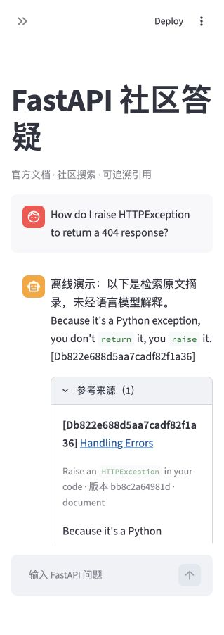
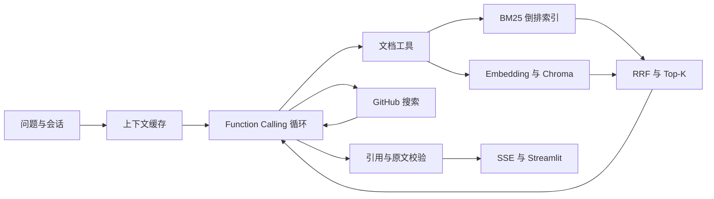

# FastAPI 文档问答 Agent

一个可运行、可阅读的个人项目：从固定版本的 FastAPI 官方文档和 GitHub Issue / PR 检索证据，通过手写 Function Calling 循环回答问题，展示引用、工具执行记录及耗时。不依赖 LangChain。

## 当前状态与验证边界

- **已验证：** demo 模式下的离线全链路（本地 Chroma + 确定性向量 + 原文摘录）、48 项 pytest、SSE 心跳/取消/总超时、索引 generation 原子切换与启动校验。
- **未验证：** 真实 DeepSeek 与 bge-m3 调用、GitHub 实时检索，以及真实模型下的引用与拒答质量。
- **评估标签：** 50 题为 AI 起草、`pending_human_review`，尚未人工复核；默认只统计 `human_verified`，复核方法见 `eval/README.md`。
- 开发过程与学习记录见 `PROGRESS.md`，逐项验证见 [`docs/VERIFICATION.md`](docs/VERIFICATION.md)。

## 快速启动：无需 Key 的演示

在项目根目录打开终端。本次已在现有 `.venv` 安装依赖，并完成演示入库；以后可以直接执行启动命令。新环境执行：

```bash
python3 -m venv .venv
source .venv/bin/activate
python -m pip install -r requirements.txt
python -m scripts.ingest --mode demo
python -m uvicorn app.api:app --host 127.0.0.1 --port 8000
```

第二个终端：

```bash
source .venv/bin/activate
python -m streamlit run ui/streamlit_app.py --server.address 127.0.0.1 --server.port 8501 --server.headless true --browser.gatherUsageStats false
```

打开 [聊天页面](http://127.0.0.1:8501)、[接口文档](http://127.0.0.1:8000/docs) 或 [健康检查](http://127.0.0.1:8000/health)。停止服务按 `Ctrl+C`。只启动一个后端进程。



演示问题：`How to declare a path parameter?`、`How do I raise HTTPException to return a 404 response?`。

演示模式使用**确定性词汇哈希向量和原文摘录**，不访问语言模型、不访问 Embedding 服务，也不执行 GitHub 请求。Chroma 是实际运行的本地数据库。演示只能验证程序、引用和协议；它没有语义理解、中文改写或真正的多轮指代能力。英文词汇重合也不保证回答了问题，语义拒答能力有限。

本次运行环境是 macOS ARM64 / Python 3.13.2，主要版本：FastAPI 0.162.0、Chroma 1.5.9、OpenAI SDK 3.31.0、Streamlit 1.66.1。`requirements.txt` 是直接依赖范围；`requirements.lock.txt` 保存本次完整安装快照，其他平台可优先用范围文件。原依赖清单保存在 `docs/history/requirements.initial.txt`。

## 切换真实服务

复制 `.env.example` 为 `.env`，只在本机编辑密钥，不要发送给 AI。已有 `.env` 时不要覆盖。

```dotenv
APP_MODE=live
INDEX_DIR=data/index-live
DEEPSEEK_API_KEY=本机填写
LLM_BASE_URL=https://api.deepseek.com
LLM_MODEL=deepseek-flash
LLM_DISABLE_THINKING=true
EMBEDDING_API_KEY=本机填写
EMBEDDING_BASE_URL=https://api.siliconflow.cn/v1
EMBEDDING_MODEL=BAAI/bge-m3
GITHUB_TOKEN=
```

然后执行 `python -m scripts.ingest --mode live`，重启后端与前端。真实入库会调用付费或限额 Embedding 接口；问答会调用模型，密钥、余额和权限由用户自行配置。GitHub 公共搜索可无 Token 使用；可选 Token 只用于提高可用额度，不需要写权限。

原计划的 `deepseek-chat` 是历史模型名。2026-10-24 查阅 [DeepSeek 官方说明](https://api-docs.deepseek.com/) 后，示例采用当前文档中的 `deepseek-flash`，模型名和地址均可配置。非 DeepSeek 的兼容服务如不接受 `thinking` 字段，可将 `LLM_DISABLE_THINKING=false`。程序使用 Chat Completions 的标准 `tools` / `tool_calls` / `tool_call_id` 协议。

**真实 DeepSeek 和 Embedding 调用尚未验证。** SDK 请求及响应格式已用确定性 HTTP 替身验证，不能等同于真实服务测试。未读取或打印用户密钥，`.env` 被 Git 忽略。

## 文档与入库

`data/official-sample/` 包含 24 篇真实官方 Markdown，来自 FastAPI **0.115.6**，提交 `bb8c2a64981d3e806575a445115f29eddf014c77`。这是可复现的小型历史语料，不代表最新版本的完整文档。MIT 许可在语料目录内。

`manifest.json` 记录仓库、版本、提交、下载时间、原文及处理后哈希、展开代码的路径与哈希。FastAPI Markdown 引用的 `docs_src` 示例已展开；来源 URL 指向固定提交。分块行号是**本地处理后的文档行号**，不能当作远端原文行号。

重新下载到新目录，避免覆盖原快照：

```bash
python -m scripts.fetch_docs --ref 0.115.6 --limit 24 --output data/raw/new-snapshot
python -m scripts.ingest --raw data/raw/new-snapshot --mode demo --size 1400 --overlap 200
```

也可以指定另一个官方标签或提交；路径列表在 `scripts/fetch_docs.py` 中，默认最多下载该列表的 24 篇。扩充范围时修改列表并同步评估标签。导入自备 Markdown 时，按示例提供 `manifest.json`（路径、固定来源 URL、SHA-256、版本），使用 `--raw` 指向该目录。加载器校验哈希及路径边界。

按标题分区，在区内用重叠窗口切分；围栏代码块尽量整体保留，超长代码块允许超过目标长度。入库批量生成向量，同时建立手写 BM25 倒排索引。当前快照产生 **413 个块**。

每次入库建立独立 generation，全部完成后原子替换 `current.json`；失败不会破坏旧索引。索引版本包含内容与 Embedding 配置签名。更换 Embedding 服务或模型后必须重建索引。**后端在启动时加载一个固定 generation；入库后重启后端生效**，`/health` 可查看正在使用的版本。历史 generation 自动保留，可在停止服务后自行清理。

## 请求流程与实现位置



| 模块 | 实现与关键行为 |
|---|---|
| `app/chunker.py` | 标题、字符窗口、重叠、围栏代码保护、稳定 ID |
| `app/bm25.py` | 分词、词频倒排表、长度归一化、JSON 保存加载 |
| `app/retriever.py` | 向量 / BM25 / 混合检索，RRF 常数 60，堆取 Top-K |
| `app/embedder.py` / `vector_store.py` | 兼容 Embedding SDK、分批及返回顺序校验、持久化 Chroma |
| `app/tools.py` | Pydantic 严格参数校验、超时、错误码、低分过滤、GitHub 固定仓库范围 |
| `app/agent.py` | 最大模型步数、每步最多三个工具、工具结果配对、引用校验及拒答 |
| `app/cache.py` | 哈希表 + 双向链表，O(1) 查询/更新/淘汰，TTL |
| `app/memory.py` | deque 保存完整轮次，同会话串行、会话容量及过期处理 |
| `app/api.py` / `service.py` | SSE、心跳、请求总超时、断连取消、会话写入 |
| `ui/streamlit_app.py` | 对话、原文引用、工具记录、耗时、用量、新会话 |

工具异常返回安全错误码，不回显可能含密钥的异常正文。向量检索失败时混合检索可降级到 BM25，并展示警告；评估中的纯向量失败会记为失败，不伪装成向量成功。HTTP 客户端设有超时，SDK 自动重试关闭，避免重试时间不可控。同步 Embedding/Chroma 在线程执行；协程超时不能强制终止已运行的同步线程，该线程仍由客户端超时约束。

## 引用、拒答与缓存边界

模型必须先调用工具。最终 JSON 的每个段落必须含有效引用，引用必须来自**本轮**工具结果，摘录必须确实存在于该证据。空证据、无效引用、编造摘录、模型异常或最大步数用尽都会返回兜底拒答。文档最低分阈值可配置，RRF 分数只用于排序，**不当作可信概率**。真实模型还需判断资料是否回答实际问题。

这些检查保证引用可追溯，不能证明每句话的语义都被资料支持；附上无关的真实引用仍可能通过机械检查，所以回答依据需要人工评估。Issue 内容是不受信任的社区报告，不能直接当官方结论；当前只搜索 Issue / PR 标题和正文，不读取评论、不搜索 Discussions。

缓存键包含原始问题（保留大小写）、完整窗口上下文、会话 ID、索引版本、模型配置和提示词版本。实时问题、调用过 GitHub 的轮次、拒答、失败和降级结果不入缓存。TTL 默认 300 秒。**同一聊天连续问两次会新增上下文，通常不会命中缓存**；评估脚本用同一会话、问题、空历史重复调用，单独测量可比的缓存命中耗时。

会话是进程内存，默认保留最近六轮，最多 256 个会话；服务重启后消失。客户端 UUID 用于隔离，不是认证机制。本项目按原计划用于本机演示，不含登录、多租户、跨进程共享或生产限流；不要直接公开部署。原计划的 Docker、Redis、Discussions 等仍属后续加分项。

## SSE 协议

```bash
curl -N http://127.0.0.1:8000/chat \
  -H 'Content-Type: application/json' \
  -d '{"message":"How to declare a path parameter?"}'
```

可附带 `session_id`（UUID）继续一段对话；不传则创建新会话。事件顺序：`meta` → 多个 `step` → `sources` → 多个 `token` → `done`；请求中断或总超时用 `error` 结束，不发成功 `done`。十秒无事件会发 SSE 注释心跳。

`step` 是工具名称、状态、来源 ID、警告与耗时，不是模型内部思维链。为了在输出前拒绝伪引用，**最终模型回答先整体获取并校验，再以 SSE 文本片段发送**；工具过程实时展示，但 `token` 事件不代表服务商逐 Token 流式传输。`done` 包含完整回答、引用、拒答原因、模式、缓存状态及用量。

## 测试与评估

本次 **48 项测试通过**；实际服务、浏览器及外部接口的验证边界见 [验证记录](docs/VERIFICATION.md)。

```bash
python -m pytest -q
ruff check app scripts ui tests eval
python -m scripts.smoke_http    # 两个服务都启动后执行
python -m scripts.check_github  # 可选，只读联网检查，不读取 .env
python -m eval.run_eval --mode demo --include-unreviewed --answers
```

50 题包括 **35 道离线文档题、5 道社区搜索题、10 道无答案题**，全部为 AI 起草、`pending_human_review`，尚未人工复核。默认评估只接受 `human_verified`；当前不带 `--include-unreviewed` 时分母为零、指标为 null。人工复核方法见 `eval/README.md`。

评估输出到独立时间戳目录，不覆盖旧报告，包含问题逐条结果、三种检索 Recall@5、MRR@20、失败/降级数、耗时、拒答率、缓存重复请求耗时，以及 `human_review.csv`。GitHub 题不进入离线 Recall 分母；拒答统计同时报告无答案题拒答率和文档题误拒率。

`eval/results/` 已有实际运行的演示报告。它们验证评估流程本身，**不代表 DeepSeek / bge-m3 的检索或拒答效果**，不能作为召回提升或幻觉抑制的效果证据。真实 Embedding 对比、真实模型拒答与人工幻觉检查仍待本地配置 Key 和复核标签后进行。

```bash
python -m eval.run_eval --mode live --answers --limit 5
# 标签完成复核后去掉 --limit，评估全部已确认的问题。
```

## 建议的学习顺序

1. 从 `scratch/day1.py` 和 `app/models.py` 理解变量、函数、列表与数据类。
2. 阅读 `loader.py` → `chunker.py`，用测试观察标题、重叠窗口与代码块。
3. 阅读 `bm25.py` → `retriever.py`，手算一个小型倒排表和 RRF 排名。
4. 阅读 `cache.py` → `memory.py`，画双向链表与最近轮次窗口。
5. 阅读 `tools.py` → `agent.py`，逐步追踪一次工具调用与拒答。
6. 最后连接 `service.py`、`api.py`、前端与评估脚本，理解一次请求如何完成。

每个模块都有可以独立运行的测试，后续学习时可以先预测结果，再运行与修改。无需重新进入 dojo 评估流程。

## 兼容性参考

- [DeepSeek 官方 API 示例](https://api-docs.deepseek.com/)
- [Chroma 的 query_embeddings 与返回结构](https://docs.trychroma.com/docs/querying-collections/query-and-get)
- [GitHub 搜索接口、限制与 incomplete_results](https://docs.github.com/en/rest/search/search#search-issues-and-pull-requests)
